# Automations V2 screenshots

Synthetic data on a local stack, taken by `bash e2e/automations-local/run.sh` at twice the pixel density, fully drawn, with the pointer resting off every control. All of them come from the builder and backend-first modes at `d40f552`. Screens taller than the window are captured as whole pages, so in those the fixed sidebar stops at the window's height. The run summaries are [`mobile-keyboard.json`](mobile-keyboard.json), [`automations-v2-editor.json`](automations-v2-editor.json) and [`automations-v2-crm.json`](automations-v2-crm.json).

## Builder

### A draft authored by keyboard

| 1440 px light | 1440 px dark |
| --- | --- |
|  | 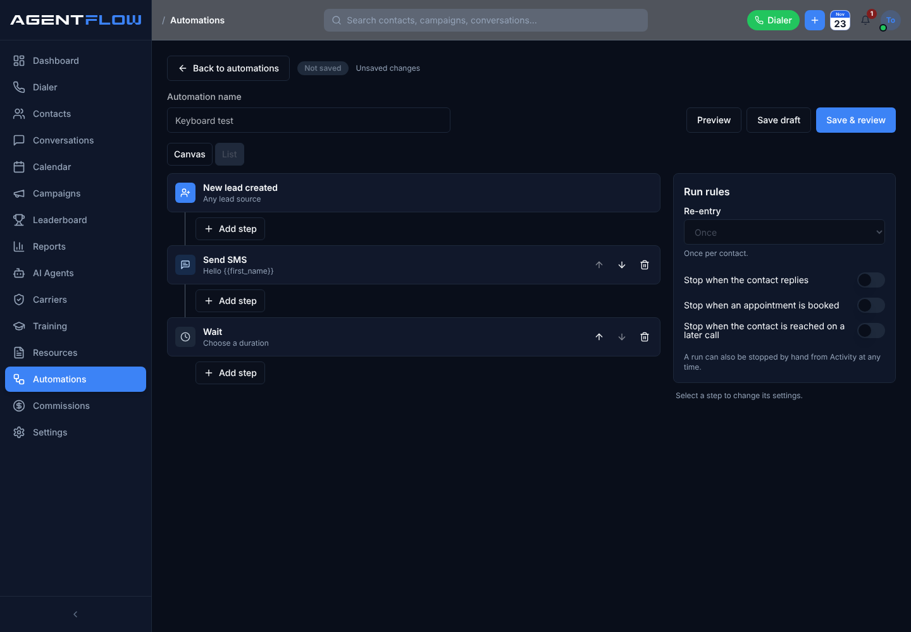 |

| 375 px light | 375 px dark |
| --- | --- |
|  |  |

### Canvas and list

| Canvas, 1440 px light | Canvas, 1440 px dark |
| --- | --- |
|  |  |

| List view, 1440 px light |
| --- |
|  |

### Message editor and publish review

| Message editor, 1440 px light | Save & review, 1440 px light |
| --- | --- |
| 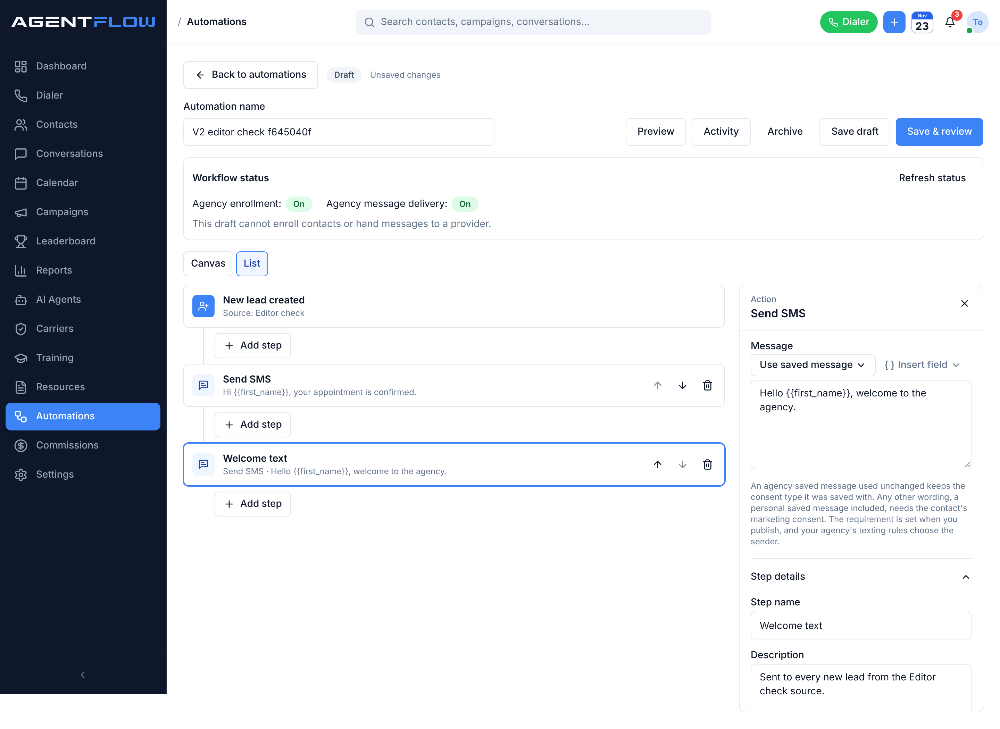 |  |

### Phone timeline and settings sheet

| Timeline, 375 px light | Timeline, 375 px dark |
| --- | --- |
| 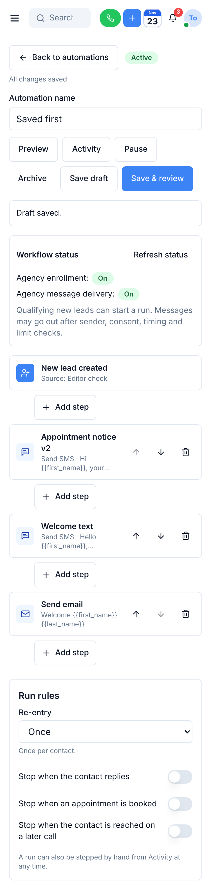 | 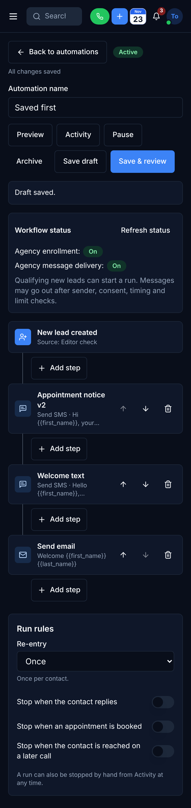 |

| Settings sheet, 375 px light | Settings sheet, 375 px dark |
| --- | --- |
| 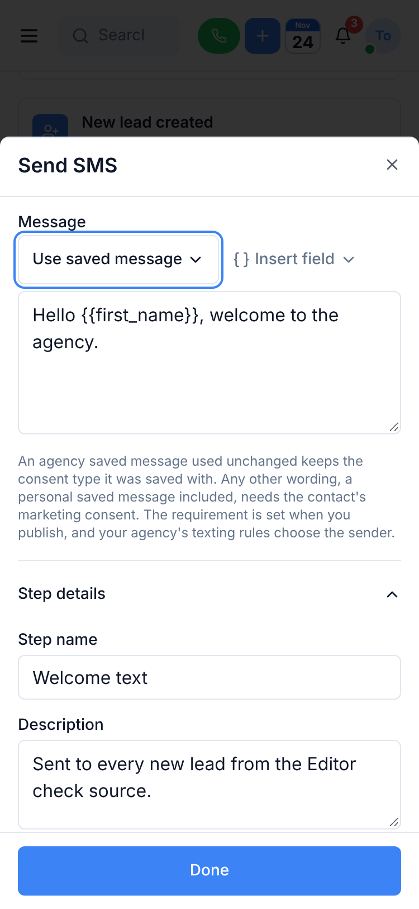 |  |

## CRM screens

### A contact with a timed automation task

| 1440 px light | 1440 px dark |
| --- | --- |
| 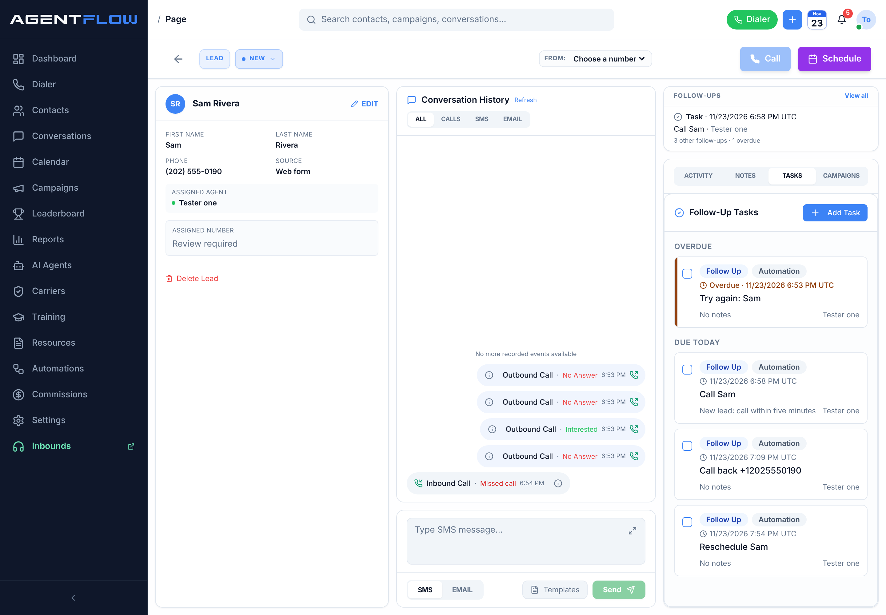 | 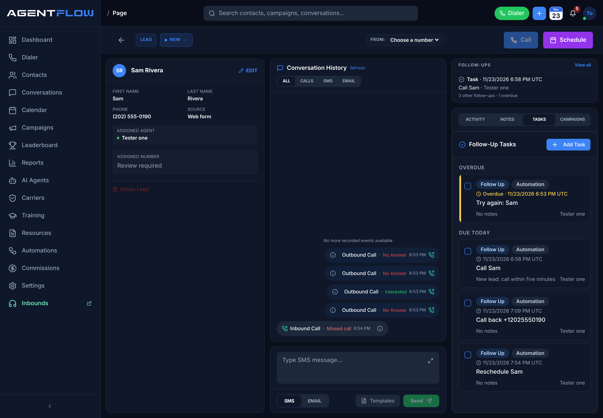 |

| 375 px light | 375 px dark |
| --- | --- |
|  |  |

### Confirm issuance

| 1440 px light | 1440 px dark |
| --- | --- |
|  | 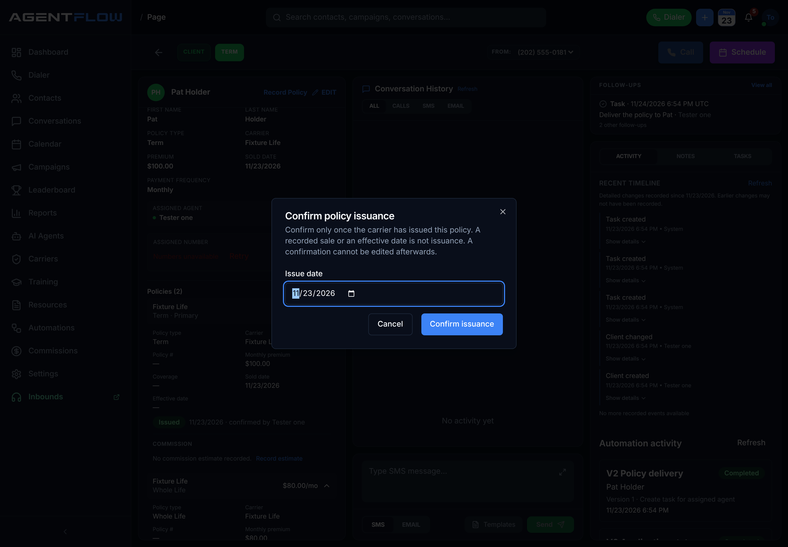 |

| 375 px light | 375 px dark |
| --- | --- |
| 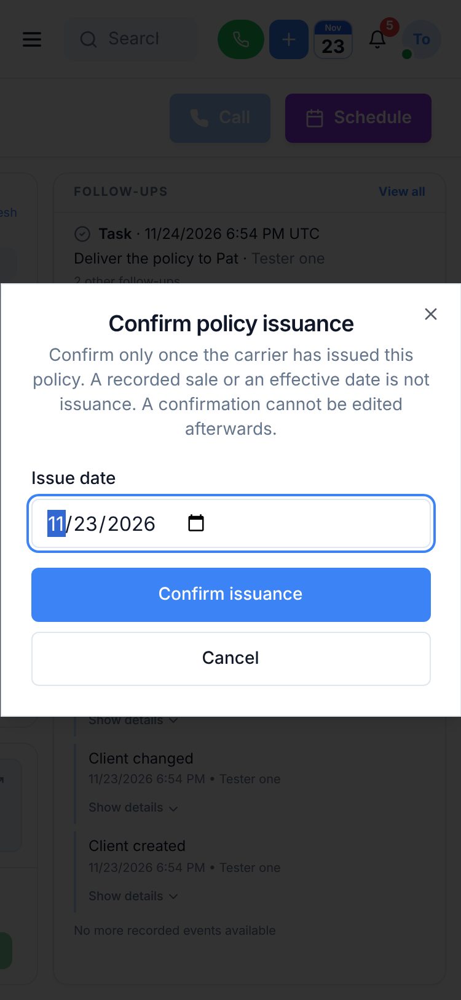 |  |

### Inbounds callbacks

The Inbounds room keeps its own dark look in either theme, so its light and dark captures are identical; the light ones are shown.

| 1440 px | 375 px |
| --- | --- |
| 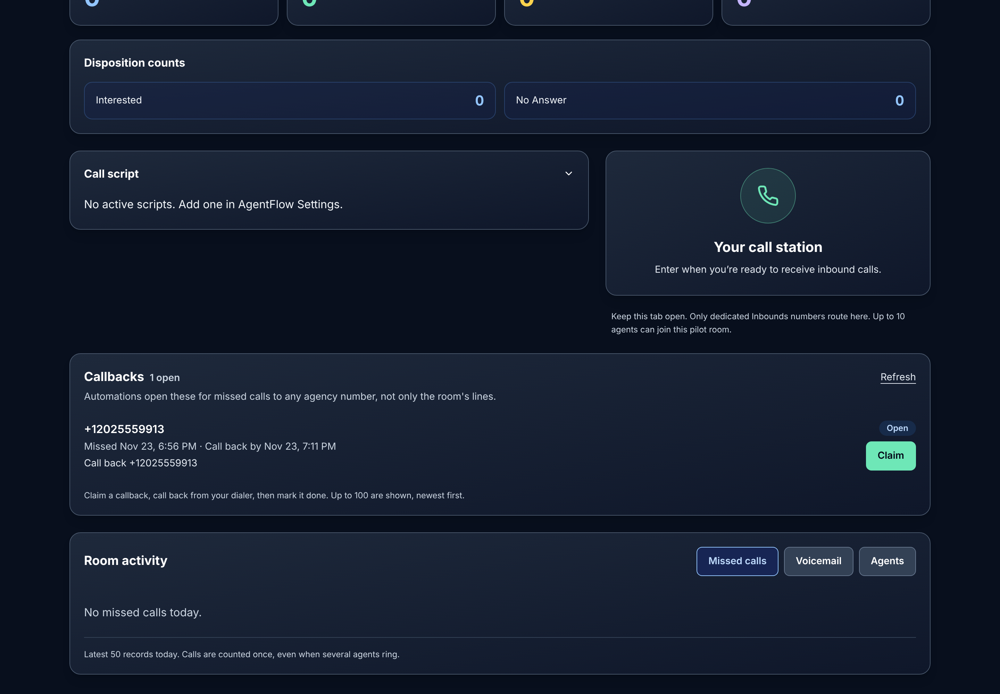 |  |

## Rollback rehearsal

| First-release automations opened in the V2 editor | First-release frontend after the rollback |
| --- | --- |
|  | 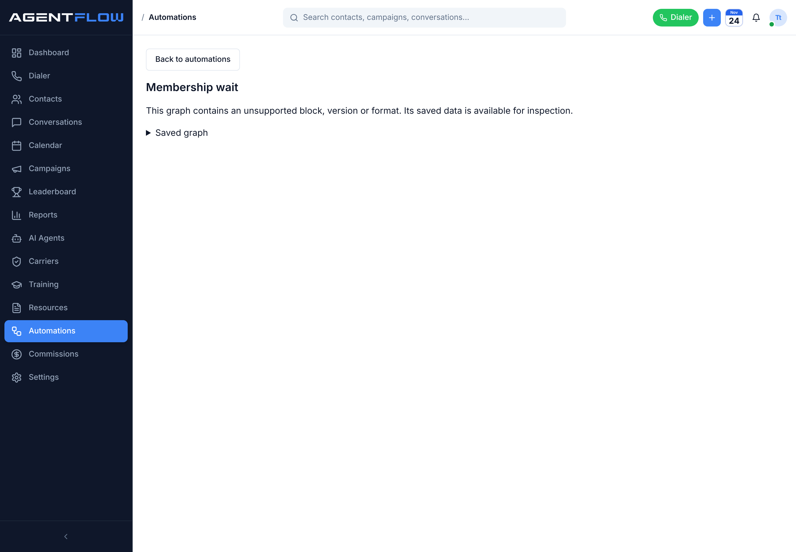 |
